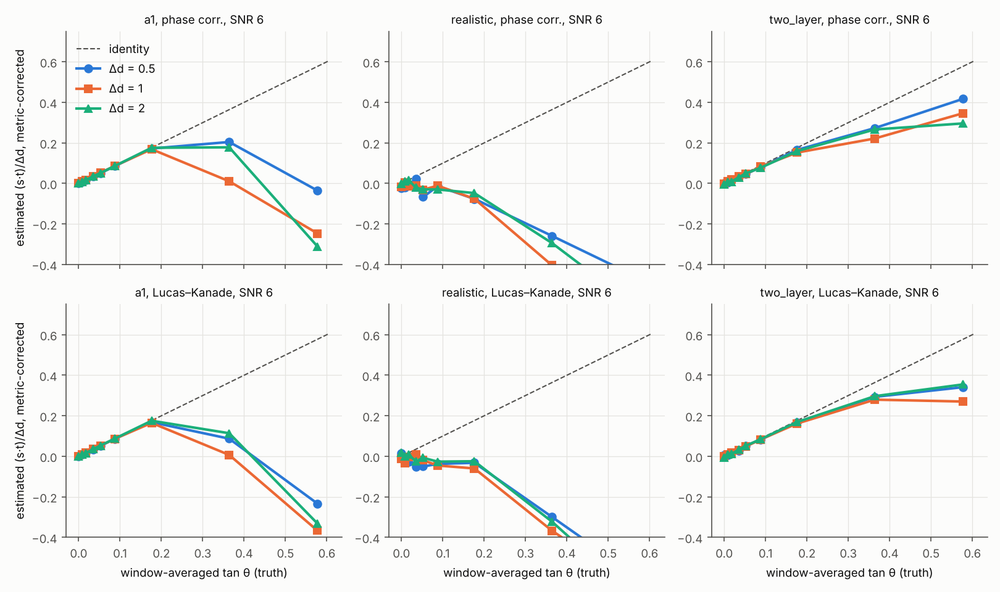
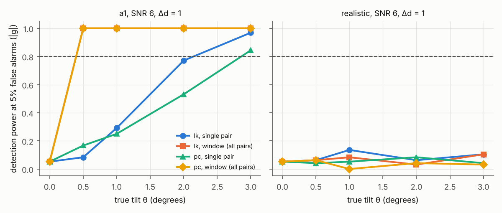
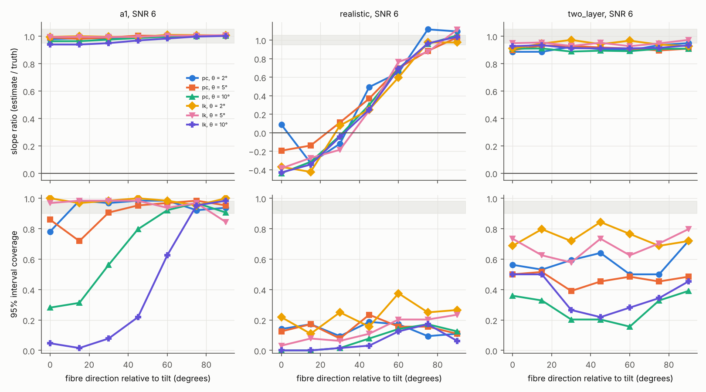
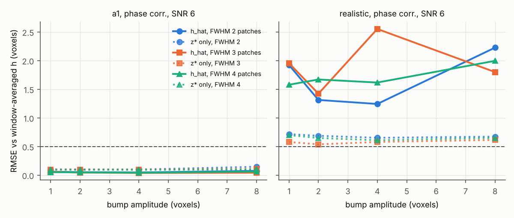
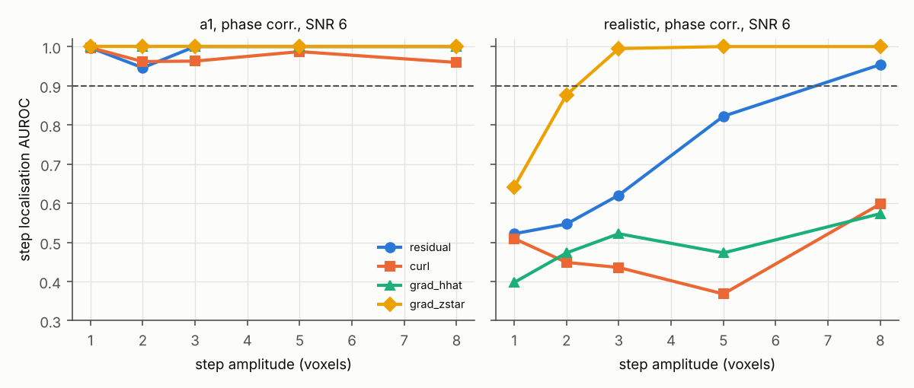
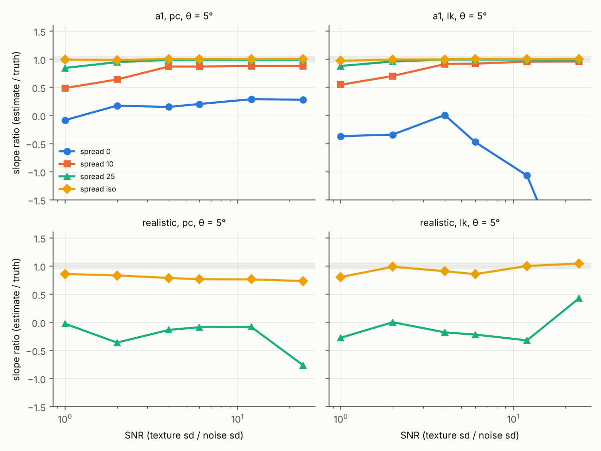
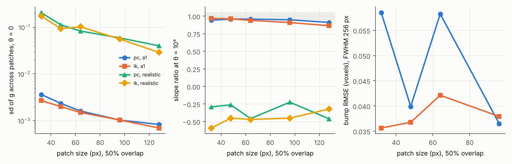

# WO-002 synthetic sweep: generated summary

Run `wo002-20261101T191224`; 1208 of 1208 cases, 0 errors; wall 40.6 min on 3 CPU workers (case CPU time 2.03 h). villa `d57c28ebee8776b618f9851c2289cc407ea99dd4`, source `9bdc19a6204a`, partial = False.

Reproduce: `uv run vch synth run --config configs/synth/wo002.toml --out runs/synth --workers 3`

## Acceptance verdicts (addendum 2 item 9)

| criterion | verdict | detail |
|---|---|---|
| P1/P2 slope, A1, SNR 6, lk | FAIL | slopes by Δd: 0.5: 0.291, 1: 0.084, 2: 0.363 (need 1 ± 0.05) |
| P1/P2 slope, A1, SNR 6, pc | FAIL | slopes by Δd: 0.5: 0.592, 1: 0.098, 2: 0.528 (need 1 ± 0.05) |
| A1 slope at θ = 20°, P = 64 (SNR 6) | FAIL | ratio lk: 0.035, pc: 0.168; patch depth span P·tan 20° = 23.3 voxels vs sheet thickness 20 |
| A1 slope at θ = 20°, P = 32 (SNR 6) | FAIL | ratio lk: -0.875, pc: -0.489; patch depth span P·tan 20° = 11.6 voxels vs sheet thickness 20 |
| Sigma calibrated, a1, lk | FAIL | coverage 0.642 (need 0.90-0.98), confident wrong sign 0.116 (need <= 0.025), 5840 patches |
| Sigma calibrated, a1, pc | FAIL | coverage 0.610 (need 0.90-0.98), confident wrong sign 0.081 (need <= 0.025), 6032 patches |
| Sigma calibrated, realistic, lk | FAIL | coverage 0.165 (need 0.90-0.98), confident wrong sign 0.489 (need <= 0.025), 5455 patches |
| Sigma calibrated, realistic, pc | FAIL | coverage 0.138 (need 0.90-0.98), confident wrong sign 0.482 (need <= 0.025), 5648 patches |
| Sigma calibrated, two_layer, lk | FAIL | coverage 0.578 (need 0.90-0.98), confident wrong sign 0.001 (need <= 0.025), 2640 patches |
| Sigma calibrated, two_layer, pc | FAIL | coverage 0.432 (need 0.90-0.98), confident wrong sign 0.010 (need <= 0.025), 2640 patches |
| pure offset |s| < 0.05 px, a1 | PASS | max per-patch |s| over offsets -10..10: 0.0058 px |
| pure offset |s| < 0.05 px, realistic | FAIL | max per-patch |s| over offsets -10..10: 0.2771 px |
| offset recovery RMSE <= 0.5, a1, lk | PASS | worst RMSE 0.049 voxels (amp >= 2, width >= 4 patches) |
| offset recovery RMSE <= 0.5, realistic, lk | FAIL | worst RMSE 1.865 voxels (amp >= 2, width >= 4 patches) |
| offset recovery RMSE <= 0.5, a1, pc | PASS | worst RMSE 0.061 voxels (amp >= 2, width >= 4 patches) |
| offset recovery RMSE <= 0.5, realistic, pc | FAIL | worst RMSE 1.994 voxels (amp >= 2, width >= 4 patches) |
| P4 ||r|| AUROC >= 0.9, a1, lk | PASS | lowest AUROC at amp >= 3: 1.000 |
| P4 ||r|| AUROC >= 0.9, realistic, lk | FAIL | lowest AUROC at amp >= 3: 0.534 |
| P4 ||r|| AUROC >= 0.9, a1, pc | PASS | lowest AUROC at amp >= 3: 1.000 |
| P4 ||r|| AUROC >= 0.9, realistic, pc | FAIL | lowest AUROC at amp >= 3: 0.620 |

## P1/P2: signed slope against window-averaged tan θ (θ ≤ 20°)

| estimator | texture | slice_step | snr | slope_theta_le_20 | intercept | slope_ok | ratio_at_30 | null_shift_px |
|---|---|---|---|---|---|---|---|---|
| lk | a1 | 0.5 | 2 | 0.262 | 0.028 | False | -0.428 | 7.3e-05 |
| lk | a1 | 0.5 | 6 | 0.291 | 0.0299 | False | -0.404 | 9.2e-06 |
| lk | a1 | 0.5 | 20 | 0.346 | 0.0278 | False | -0.482 | 0.000133 |
| lk | a1 | 1 | 2 | 0.0345 | 0.0402 | False | -0.539 | 0.00325 |
| lk | a1 | 1 | 6 | 0.0844 | 0.0387 | False | -0.635 | 0.000274 |
| lk | a1 | 1 | 20 | 0.143 | 0.0363 | False | -0.614 | 3.14e-05 |
| lk | a1 | 2 | 2 | 0.372 | 0.0284 | False | -0.616 | 0.00149 |
| lk | a1 | 2 | 6 | 0.363 | 0.028 | False | -0.574 | 0.00283 |
| lk | a1 | 2 | 20 | 0.374 | 0.0271 | False | -0.575 | 0.000567 |
| lk | realistic | 0.5 | 2 | -0.558 | 0.0123 | False | -1.03 | 0.00112 |
| lk | realistic | 0.5 | 6 | -0.712 | 0.00278 | False | -1.05 | 0.00711 |
| lk | realistic | 0.5 | 20 | -0.775 | 0.0186 | False | -1.03 | 0.0191 |
| lk | realistic | 1 | 2 | -0.748 | 0.0254 | False | -1.11 | 0.0246 |
| lk | realistic | 1 | 6 | -0.933 | 0.02 | False | -1.15 | 0.0127 |
| lk | realistic | 1 | 20 | -0.884 | 0.0192 | False | -1.18 | 0.036 |
| lk | realistic | 2 | 2 | -0.909 | 0.0308 | False | -1.22 | 0.0653 |
| lk | realistic | 2 | 6 | -0.841 | 0.0304 | False | -1.24 | 0.0336 |
| lk | realistic | 2 | 20 | -0.757 | 0.022 | False | -1.28 | 0.0575 |
| lk | two_layer | 0.5 | 2 | 0.781 | 0.00727 | False | 0.536 | 0.00172 |
| lk | two_layer | 0.5 | 6 | 0.817 | 0.00555 | False | 0.591 | 0.00229 |
| lk | two_layer | 0.5 | 20 | 0.826 | 0.00531 | False | 0.617 | 0.000662 |
| lk | two_layer | 1 | 2 | 0.802 | 0.00647 | False | 0.536 | 0.000454 |
| lk | two_layer | 1 | 6 | 0.779 | 0.0065 | False | 0.468 | 0.000323 |
| lk | two_layer | 1 | 20 | 0.718 | 0.0105 | False | 0.491 | 0.00327 |
| lk | two_layer | 2 | 2 | 0.808 | 0.00433 | False | 0.621 | 0.00567 |
| lk | two_layer | 2 | 6 | 0.833 | 0.00416 | False | 0.614 | 0.0107 |
| lk | two_layer | 2 | 20 | 0.765 | 0.00708 | False | 0.664 | 0.00121 |
| pc | a1 | 0.5 | 2 | 0.562 | 0.0148 | False | -0.0363 | 0.000619 |
| pc | a1 | 0.5 | 6 | 0.592 | 0.0168 | False | -0.061 | 0.000196 |
| pc | a1 | 0.5 | 20 | 0.631 | 0.0154 | False | -0.062 | 1.38e-05 |
| pc | a1 | 1 | 2 | 0.245 | 0.0306 | False | -0.309 | 0.00077 |
| pc | a1 | 1 | 6 | 0.098 | 0.0382 | False | -0.427 | 0.000143 |
| pc | a1 | 1 | 20 | 0.148 | 0.0362 | False | -0.492 | 0.000159 |
| pc | a1 | 2 | 2 | 0.414 | 0.0254 | False | -0.164 | 0.00468 |
| pc | a1 | 2 | 6 | 0.528 | 0.0201 | False | -0.538 | 0.000112 |
| pc | a1 | 2 | 20 | 0.576 | 0.018 | False | -0.416 | 0.000129 |
| pc | realistic | 0.5 | 2 | -0.601 | 0.0259 | False | -0.64 | 0.018 |
| pc | realistic | 0.5 | 6 | -0.661 | 0.00559 | False | -0.812 | 0.012 |
| pc | realistic | 0.5 | 20 | -0.53 | 0.00566 | False | -0.798 | 0.00621 |
| pc | realistic | 1 | 2 | -0.71 | 0.0158 | False | -0.986 | 0.0562 |
| pc | realistic | 1 | 6 | -1.05 | 0.027 | False | -1.07 | 0.0179 |
| pc | realistic | 1 | 20 | -0.685 | 0.0295 | False | -1.07 | 0.000117 |
| pc | realistic | 2 | 2 | -0.662 | 0.0143 | False | -1.16 | 0.00679 |
| pc | realistic | 2 | 6 | -0.779 | 0.0226 | False | -1.08 | 0.00476 |
| pc | realistic | 2 | 20 | -0.77 | 0.0143 | False | -1.06 | 0.0116 |
| pc | two_layer | 0.5 | 2 | 0.809 | 0.00493 | False | 0.628 | 0.00257 |
| pc | two_layer | 0.5 | 6 | 0.767 | 0.00644 | False | 0.723 | 0.000298 |
| pc | two_layer | 0.5 | 20 | 0.853 | 0.00353 | False | 0.677 | 0.00174 |
| pc | two_layer | 1 | 2 | 0.715 | 0.00507 | False | 0.474 | 0.000933 |
| pc | two_layer | 1 | 6 | 0.623 | 0.0127 | False | 0.6 | 0.00274 |
| pc | two_layer | 1 | 20 | 0.707 | 0.00811 | False | 0.579 | 0.00208 |
| pc | two_layer | 2 | 2 | 0.811 | 0.00154 | False | 0.713 | 0.00143 |
| pc | two_layer | 2 | 6 | 0.756 | 0.00392 | False | 0.513 | 0.0111 |
| pc | two_layer | 2 | 20 | 0.761 | 0.00426 | False | 0.524 | 0.00383 |

## Minimum detectable tilt (power 0.8 at 5% false alarms)

| estimator | texture | pairs | null_sd_g | n_null_patches | MDT_deg_unknown_direction | MDT_deg_known_direction |
|---|---|---|---|---|---|---|
| lk | a1 | single pair | 0.0128 | 96 | 2.15 | 1.92 |
| lk | a1 | window (all pairs) | 0.0013 | 96 | 0.395 | 0.395 |
| lk | realistic | single pair | 0.1 | 96 | nan | nan |
| lk | realistic | window (all pairs) | 0.0743 | 96 | nan | nan |
| pc | a1 | single pair | 0.0155 | 96 | 2.86 | 2.77 |
| pc | a1 | window (all pairs) | 0.00185 | 96 | 0.395 | 0.395 |
| pc | realistic | single pair | 0.126 | 96 | nan | nan |
| pc | realistic | window (all pairs) | 0.109 | 96 | nan | nan |

## Estimator benchmark (efficiency = multi-layer CRLB / variance across patches)

| texture | estimator | median | mean | count |
|---|---|---|---|---|
| a1 | lk | 0.132 | 0.388 | 153 |
| a1 | pc | 0.0924 | 0.531 | 153 |
| realistic | lk | 0.0453 | 11.7 | 153 |
| realistic | pc | 0.0287 | 17.3 | 153 |

Decision: **pc** (lk only if its mean efficiency over realistic configurations exceeds pc's by >10%; ties to pc; pc 17.3, lk 11.7).

## Sigma calibration along the tilt (all tilt cases, all runs)

| texture | estimator | patches | coverage95 | z_sd | z_median_abs | confident_wrong_sign |
|---|---|---|---|---|---|---|
| a1 | lk | 5840 | 0.642 | 28 | 1.19 | 0.116 |
| a1 | pc | 6032 | 0.61 | 21.9 | 1.43 | 0.081 |
| realistic | lk | 5455 | 0.165 | 71.3 | 7.26 | 0.489 |
| realistic | pc | 5648 | 0.138 | 28.8 | 8.21 | 0.482 |
| two_layer | lk | 2640 | 0.578 | 9.2 | 1.59 | 0.0012 |
| two_layer | pc | 2640 | 0.432 | 9.3 | 2.38 | 0.00962 |

## Fibre orientation relative to the tilt

| texture | estimator | theta_deg | angle | ratio | coverage95 | confident_wrong_sign | patches |
|---|---|---|---|---|---|---|---|
| a1 | lk | 2 | 0 | 0.995 | 1 | 0 | 64 |
| a1 | lk | 2 | 15 | 1 | 0.969 | 0 | 64 |
| a1 | lk | 2 | 30 | 0.996 | 0.984 | 0 | 64 |
| a1 | lk | 2 | 45 | 0.993 | 1 | 0 | 64 |
| a1 | lk | 2 | 60 | 1.01 | 0.984 | 0 | 64 |
| a1 | lk | 2 | 75 | 1.01 | 0.953 | 0 | 64 |
| a1 | lk | 2 | 90 | 1.01 | 1 | 0 | 64 |
| a1 | lk | 5 | 0 | 0.994 | 0.969 | 0 | 64 |
| a1 | lk | 5 | 15 | 0.995 | 0.984 | 0 | 64 |
| a1 | lk | 5 | 30 | 0.994 | 0.984 | 0 | 64 |
| a1 | lk | 5 | 45 | 0.995 | 0.984 | 0 | 64 |
| a1 | lk | 5 | 60 | 1 | 0.938 | 0 | 64 |
| a1 | lk | 5 | 75 | 1 | 0.969 | 0 | 64 |
| a1 | lk | 5 | 90 | 1.01 | 0.844 | 0 | 64 |
| a1 | lk | 10 | 0 | 0.94 | 0.0469 | 0 | 64 |
| a1 | lk | 10 | 15 | 0.939 | 0.0156 | 0 | 64 |
| a1 | lk | 10 | 30 | 0.949 | 0.0781 | 0 | 64 |
| a1 | lk | 10 | 45 | 0.969 | 0.219 | 0 | 64 |
| a1 | lk | 10 | 60 | 0.983 | 0.625 | 0 | 64 |
| a1 | lk | 10 | 75 | 0.997 | 0.953 | 0 | 64 |
| a1 | lk | 10 | 90 | 1 | 0.984 | 0 | 64 |
| a1 | pc | 2 | 0 | 0.979 | 0.781 | 0 | 64 |
| a1 | pc | 2 | 15 | 0.985 | 0.984 | 0 | 64 |
| a1 | pc | 2 | 30 | 0.984 | 0.969 | 0 | 64 |
| a1 | pc | 2 | 45 | 0.994 | 0.984 | 0 | 64 |
| a1 | pc | 2 | 60 | 0.996 | 0.984 | 0 | 64 |
| a1 | pc | 2 | 75 | 1.01 | 0.922 | 0 | 64 |
| a1 | pc | 2 | 90 | 1.01 | 0.938 | 0 | 64 |
| a1 | pc | 5 | 0 | 0.992 | 0.859 | 0 | 64 |
| a1 | pc | 5 | 15 | 0.981 | 0.719 | 0 | 64 |
| a1 | pc | 5 | 30 | 0.991 | 0.906 | 0 | 64 |
| a1 | pc | 5 | 45 | 1 | 0.953 | 0 | 64 |
| a1 | pc | 5 | 60 | 1 | 0.969 | 0 | 64 |
| a1 | pc | 5 | 75 | 1 | 0.984 | 0 | 64 |
| a1 | pc | 5 | 90 | 1.01 | 0.953 | 0 | 64 |
| a1 | pc | 10 | 0 | 0.963 | 0.281 | 0 | 64 |
| a1 | pc | 10 | 15 | 0.964 | 0.312 | 0 | 64 |
| a1 | pc | 10 | 30 | 0.975 | 0.562 | 0 | 64 |
| a1 | pc | 10 | 45 | 0.987 | 0.797 | 0 | 64 |
| a1 | pc | 10 | 60 | 0.997 | 0.922 | 0 | 64 |
| a1 | pc | 10 | 75 | 1 | 0.969 | 0 | 64 |
| a1 | pc | 10 | 90 | 1 | 0.906 | 0 | 64 |
| realistic | lk | 2 | 0 | -0.369 | 0.219 | 0.422 | 64 |
| realistic | lk | 2 | 15 | -0.423 | 0.109 | 0.469 | 64 |
| realistic | lk | 2 | 30 | 0.0771 | 0.25 | 0.344 | 64 |
| realistic | lk | 2 | 45 | 0.249 | 0.156 | 0.328 | 64 |
| realistic | lk | 2 | 60 | 0.597 | 0.375 | 0.188 | 64 |
| realistic | lk | 2 | 75 | 0.975 | 0.25 | 0.109 | 64 |
| realistic | lk | 2 | 90 | 0.974 | 0.266 | 0.188 | 64 |
| realistic | lk | 5 | 0 | -0.385 | 0.0312 | 0.578 | 64 |
| realistic | lk | 5 | 15 | -0.273 | 0.0781 | 0.5 | 64 |
| realistic | lk | 5 | 30 | -0.185 | 0.0625 | 0.453 | 64 |
| realistic | lk | 5 | 45 | 0.239 | 0.109 | 0.281 | 64 |
| realistic | lk | 5 | 60 | 0.765 | 0.203 | 0.0469 | 64 |
| realistic | lk | 5 | 75 | 0.871 | 0.203 | 0.0156 | 64 |
| realistic | lk | 5 | 90 | 1.11 | 0.234 | 0.0156 | 64 |
| realistic | lk | 10 | 0 | -0.43 | 0 | 0.812 | 64 |
| realistic | lk | 10 | 15 | -0.344 | 0 | 0.641 | 64 |
| realistic | lk | 10 | 30 | -0.0462 | 0.0156 | 0.453 | 64 |
| realistic | lk | 10 | 45 | 0.249 | 0.0312 | 0.172 | 64 |
| realistic | lk | 10 | 60 | 0.688 | 0.125 | 0.0156 | 64 |
| realistic | lk | 10 | 75 | 0.964 | 0.172 | 0 | 64 |
| realistic | lk | 10 | 90 | 1.04 | 0.0625 | 0 | 64 |
| realistic | pc | 2 | 0 | 0.0875 | 0.141 | 0.391 | 64 |
| realistic | pc | 2 | 15 | -0.327 | 0.172 | 0.422 | 64 |
| realistic | pc | 2 | 30 | -0.119 | 0.0938 | 0.438 | 64 |
| realistic | pc | 2 | 45 | 0.493 | 0.188 | 0.281 | 64 |
| realistic | pc | 2 | 60 | 0.648 | 0.172 | 0.266 | 64 |
| realistic | pc | 2 | 75 | 1.12 | 0.0938 | 0.203 | 64 |
| realistic | pc | 2 | 90 | 1.09 | 0.109 | 0.188 | 64 |
| realistic | pc | 5 | 0 | -0.194 | 0.125 | 0.5 | 64 |
| realistic | pc | 5 | 15 | -0.139 | 0.172 | 0.406 | 64 |
| realistic | pc | 5 | 30 | 0.11 | 0.0781 | 0.391 | 64 |
| realistic | pc | 5 | 45 | 0.368 | 0.234 | 0.266 | 64 |
| realistic | pc | 5 | 60 | 0.696 | 0.156 | 0.188 | 64 |
| realistic | pc | 5 | 75 | 0.883 | 0.156 | 0.0625 | 64 |
| realistic | pc | 5 | 90 | 1.03 | 0.109 | 0.0156 | 64 |
| realistic | pc | 10 | 0 | -0.437 | 0 | 0.609 | 64 |
| realistic | pc | 10 | 15 | -0.315 | 0 | 0.672 | 64 |
| realistic | pc | 10 | 30 | -0.0328 | 0.0156 | 0.422 | 64 |
| realistic | pc | 10 | 45 | 0.3 | 0.0781 | 0.203 | 64 |
| realistic | pc | 10 | 60 | 0.694 | 0.141 | 0 | 64 |
| realistic | pc | 10 | 75 | 0.958 | 0.172 | 0 | 64 |
| realistic | pc | 10 | 90 | 1.05 | 0.125 | 0 | 64 |
| two_layer | lk | 2 | 0 | 0.91 | 0.688 | 0 | 64 |
| two_layer | lk | 2 | 15 | 0.946 | 0.797 | 0 | 64 |
| two_layer | lk | 2 | 30 | 0.973 | 0.719 | 0 | 64 |
| two_layer | lk | 2 | 45 | 0.942 | 0.844 | 0 | 64 |
| two_layer | lk | 2 | 60 | 0.968 | 0.766 | 0 | 64 |
| two_layer | lk | 2 | 75 | 0.939 | 0.688 | 0 | 64 |
| two_layer | lk | 2 | 90 | 0.928 | 0.719 | 0 | 64 |
| two_layer | lk | 5 | 0 | 0.949 | 0.734 | 0 | 64 |
| two_layer | lk | 5 | 15 | 0.954 | 0.625 | 0 | 64 |
| two_layer | lk | 5 | 30 | 0.929 | 0.578 | 0 | 64 |
| two_layer | lk | 5 | 45 | 0.952 | 0.734 | 0 | 64 |
| two_layer | lk | 5 | 60 | 0.928 | 0.625 | 0 | 64 |
| two_layer | lk | 5 | 75 | 0.948 | 0.703 | 0 | 64 |
| two_layer | lk | 5 | 90 | 0.973 | 0.797 | 0 | 64 |
| two_layer | lk | 10 | 0 | 0.927 | 0.5 | 0 | 64 |
| two_layer | lk | 10 | 15 | 0.934 | 0.5 | 0 | 64 |
| two_layer | lk | 10 | 30 | 0.913 | 0.266 | 0 | 64 |
| two_layer | lk | 10 | 45 | 0.912 | 0.219 | 0 | 64 |
| two_layer | lk | 10 | 60 | 0.912 | 0.281 | 0 | 64 |
| two_layer | lk | 10 | 75 | 0.915 | 0.344 | 0 | 64 |
| two_layer | lk | 10 | 90 | 0.933 | 0.453 | 0 | 64 |
| two_layer | pc | 2 | 0 | 0.886 | 0.562 | 0 | 64 |
| two_layer | pc | 2 | 15 | 0.886 | 0.531 | 0 | 64 |
| two_layer | pc | 2 | 30 | 0.922 | 0.594 | 0 | 64 |
| two_layer | pc | 2 | 45 | 0.906 | 0.641 | 0 | 64 |
| two_layer | pc | 2 | 60 | 0.897 | 0.5 | 0 | 64 |
| two_layer | pc | 2 | 75 | 0.935 | 0.5 | 0 | 64 |
| two_layer | pc | 2 | 90 | 0.949 | 0.719 | 0 | 64 |
| two_layer | pc | 5 | 0 | 0.898 | 0.5 | 0 | 64 |
| two_layer | pc | 5 | 15 | 0.932 | 0.516 | 0 | 64 |
| two_layer | pc | 5 | 30 | 0.93 | 0.391 | 0 | 64 |
| two_layer | pc | 5 | 45 | 0.918 | 0.453 | 0 | 64 |
| two_layer | pc | 5 | 60 | 0.91 | 0.484 | 0 | 64 |
| two_layer | pc | 5 | 75 | 0.896 | 0.453 | 0 | 64 |
| two_layer | pc | 5 | 90 | 0.909 | 0.484 | 0 | 64 |
| two_layer | pc | 10 | 0 | 0.909 | 0.359 | 0 | 64 |
| two_layer | pc | 10 | 15 | 0.911 | 0.328 | 0 | 64 |
| two_layer | pc | 10 | 30 | 0.888 | 0.203 | 0 | 64 |
| two_layer | pc | 10 | 45 | 0.894 | 0.203 | 0 | 64 |
| two_layer | pc | 10 | 60 | 0.891 | 0.156 | 0 | 64 |
| two_layer | pc | 10 | 75 | 0.908 | 0.328 | 0 | 64 |
| two_layer | pc | 10 | 90 | 0.909 | 0.391 | 0 | 64 |

## Offset recovery (bumps)

| estimator | texture | amp | width | rmse_lsq | rmse_fc | rmse_zstar | shape_rmse_lsq |
|---|---|---|---|---|---|---|---|
| lk | a1 | 1 | 2 | 0.0578 | 0.0575 | 0.0984 | 0.0334 |
| lk | a1 | 2 | 2 | 0.0447 | 0.0401 | 0.0953 | 0.0344 |
| lk | a1 | 4 | 2 | 0.0493 | 0.0408 | 0.0938 | 0.0419 |
| lk | a1 | 8 | 2 | 0.0848 | 0.0403 | 0.128 | 0.0824 |
| lk | a1 | 1 | 3 | 0.0495 | 0.0506 | 0.0973 | 0.0239 |
| lk | a1 | 2 | 3 | 0.0409 | 0.0433 | 0.0956 | 0.0239 |
| lk | a1 | 4 | 3 | 0.0394 | 0.0423 | 0.0974 | 0.0355 |
| lk | a1 | 8 | 3 | 0.0453 | 0.0377 | 0.1 | 0.0438 |
| lk | a1 | 1 | 4 | 0.0514 | 0.0542 | 0.0966 | 0.0214 |
| lk | a1 | 2 | 4 | 0.0451 | 0.0466 | 0.0939 | 0.0251 |
| lk | a1 | 4 | 4 | 0.0488 | 0.059 | 0.0908 | 0.0391 |
| lk | a1 | 8 | 4 | 0.0412 | 0.043 | 0.0954 | 0.0346 |
| pc | a1 | 1 | 2 | 0.0594 | 0.0662 | 0.0966 | 0.0302 |
| pc | a1 | 2 | 2 | 0.0511 | 0.0532 | 0.096 | 0.0402 |
| pc | a1 | 4 | 2 | 0.0456 | 0.042 | 0.0969 | 0.038 |
| pc | a1 | 8 | 2 | 0.0737 | 0.0511 | 0.145 | 0.0692 |
| pc | a1 | 1 | 3 | 0.0576 | 0.0572 | 0.0973 | 0.0307 |
| pc | a1 | 2 | 3 | 0.044 | 0.0495 | 0.0963 | 0.0267 |
| pc | a1 | 4 | 3 | 0.0368 | 0.047 | 0.0966 | 0.0287 |
| pc | a1 | 8 | 3 | 0.0408 | 0.0446 | 0.105 | 0.0382 |
| pc | a1 | 1 | 4 | 0.0512 | 0.0548 | 0.0958 | 0.0236 |
| pc | a1 | 2 | 4 | 0.0474 | 0.0489 | 0.0947 | 0.0299 |
| pc | a1 | 4 | 4 | 0.0402 | 0.0486 | 0.0919 | 0.0297 |
| pc | a1 | 8 | 4 | 0.0607 | 0.0649 | 0.0987 | 0.0571 |
| lk | realistic | 1 | 2 | 1.05 | 1.43 | 0.605 | 1.05 |
| lk | realistic | 2 | 2 | 1.33 | 1.79 | 0.578 | 1.33 |
| lk | realistic | 4 | 2 | 1.39 | 1.75 | 0.651 | 1.37 |
| lk | realistic | 8 | 2 | 1.72 | 2.08 | 0.549 | 1.72 |
| lk | realistic | 1 | 3 | 1.36 | 1.92 | 0.593 | 1.35 |
| lk | realistic | 2 | 3 | 1.42 | 2.12 | 0.552 | 1.42 |
| lk | realistic | 4 | 3 | 1.9 | 2.28 | 0.541 | 1.89 |
| lk | realistic | 8 | 3 | 2.03 | 2.82 | 0.634 | 2.03 |
| lk | realistic | 1 | 4 | 1.34 | 2.73 | 0.633 | 1.34 |
| lk | realistic | 2 | 4 | 1.64 | 3.34 | 0.596 | 1.64 |
| lk | realistic | 4 | 4 | 1.87 | 2.68 | 0.616 | 1.87 |
| lk | realistic | 8 | 4 | 1.39 | 1.98 | 0.611 | 1.39 |
| pc | realistic | 1 | 2 | 1.92 | 2.77 | 0.714 | 1.92 |
| pc | realistic | 2 | 2 | 1.31 | 1.68 | 0.686 | 1.31 |
| pc | realistic | 4 | 2 | 1.24 | 1.43 | 0.651 | 1.24 |
| pc | realistic | 8 | 2 | 2.22 | 2.84 | 0.671 | 2.22 |
| pc | realistic | 1 | 3 | 1.95 | 3.3 | 0.577 | 1.95 |
| pc | realistic | 2 | 3 | 1.42 | 2.23 | 0.537 | 1.42 |
| pc | realistic | 4 | 3 | 2.55 | 3.35 | 0.578 | 2.55 |
| pc | realistic | 8 | 3 | 1.8 | 2.63 | 0.614 | 1.8 |
| pc | realistic | 1 | 4 | 1.58 | 1.99 | 0.697 | 1.58 |
| pc | realistic | 2 | 4 | 1.67 | 2.4 | 0.647 | 1.67 |
| pc | realistic | 4 | 4 | 1.62 | 2.46 | 0.608 | 1.62 |
| pc | realistic | 8 | 4 | 1.99 | 2.59 | 0.649 | 1.99 |

## Step detection (P4)

| estimator | texture | amp | auroc_residual | auroc_curl | auroc_grad_hhat | auroc_grad_zstar | curl_pos_above_null_q95 |
|---|---|---|---|---|---|---|---|
| lk | a1 | 0 | 0.446 | 0.43 | 0.504 | 0.422 | 0 |
| lk | a1 | 1 | 0.995 | 0.949 | 1 | 1 | 0.833 |
| lk | a1 | 2 | 0.982 | 0.93 | 1 | 1 | 0.875 |
| lk | a1 | 3 | 1 | 0.964 | 1 | 1 | 0.917 |
| lk | a1 | 5 | 1 | 0.999 | 1 | 1 | 1 |
| lk | a1 | 8 | 1 | 0.999 | 1 | 1 | 1 |
| lk | realistic | 0 | 0.639 | 0.439 | 0.452 | 0.465 | 0 |
| lk | realistic | 1 | 0.55 | 0.378 | 0.452 | 0.759 | 0.0417 |
| lk | realistic | 2 | 0.562 | 0.564 | 0.657 | 0.909 | 0.167 |
| lk | realistic | 3 | 0.534 | 0.492 | 0.537 | 0.967 | 0.0833 |
| lk | realistic | 5 | 0.907 | 0.428 | 0.628 | 0.992 | 0 |
| lk | realistic | 8 | 0.961 | 0.45 | 0.564 | 1 | 0.0417 |
| pc | a1 | 0 | 0.359 | 0.452 | 0.324 | 0.3 | 0.0417 |
| pc | a1 | 1 | 0.997 | 0.997 | 1 | 1 | 0.958 |
| pc | a1 | 2 | 0.946 | 0.962 | 1 | 1 | 0.875 |
| pc | a1 | 3 | 1 | 0.963 | 1 | 1 | 0.833 |
| pc | a1 | 5 | 1 | 0.987 | 1 | 1 | 0.958 |
| pc | a1 | 8 | 1 | 0.959 | 1 | 1 | 0.917 |
| pc | realistic | 0 | 0.479 | 0.428 | 0.498 | 0.278 | 0.0417 |
| pc | realistic | 1 | 0.522 | 0.51 | 0.398 | 0.641 | 0.0833 |
| pc | realistic | 2 | 0.547 | 0.449 | 0.473 | 0.877 | 0 |
| pc | realistic | 3 | 0.62 | 0.436 | 0.522 | 0.995 | 0.0417 |
| pc | realistic | 5 | 0.822 | 0.368 | 0.473 | 1 | 0 |
| pc | realistic | 8 | 0.954 | 0.598 | 0.573 | 1 | 0.167 |

## Failure envelope (θ, SNR, anisotropy)

| estimator | texture | theta | snr | spread | ratio | cv | eff |
|---|---|---|---|---|---|---|---|
| lk | a1 | 2 | 1 | 0 | -0.901 | 2.43 | 7.03 |
| lk | a1 | 2 | 2 | 0 | 0.173 | 2.83 | 1.3 |
| lk | a1 | 2 | 4 | 0 | 0.205 | 1.35 | 1.14 |
| lk | a1 | 2 | 6 | 0 | -0.672 | 2.28 | 0.221 |
| lk | a1 | 2 | 12 | 0 | -0.182 | 1.76 | 0.0743 |
| lk | a1 | 2 | 24 | 0 | -1.57 | 1.52 | 0.0251 |
| lk | a1 | 2 | 1 | 10 | -0.0987 | 1.28 | 0.0479 |
| lk | a1 | 2 | 2 | 10 | 0.637 | 0.504 | 0.0763 |
| lk | a1 | 2 | 4 | 10 | 0.867 | 0.117 | 0.351 |
| lk | a1 | 2 | 6 | 10 | 0.896 | 0.106 | 0.19 |
| lk | a1 | 2 | 12 | 10 | 0.957 | 0.0565 | 0.167 |
| lk | a1 | 2 | 24 | 10 | 0.971 | 0.0303 | 0.145 |
| lk | a1 | 2 | 1 | 25 | 0.932 | 0.508 | 0.0479 |
| lk | a1 | 2 | 2 | 25 | 0.969 | 0.153 | 0.129 |
| lk | a1 | 2 | 4 | 25 | 0.978 | 0.0618 | 0.194 |
| lk | a1 | 2 | 6 | 25 | 0.975 | 0.051 | 0.101 |
| lk | a1 | 2 | 12 | 25 | 0.998 | 0.0198 | 0.168 |
| lk | a1 | 2 | 24 | 25 | 1 | 0.00832 | 0.237 |
| lk | a1 | 2 | 1 | iso | 1.06 | 0.146 | 0.149 |
| lk | a1 | 2 | 2 | iso | 1 | 0.0589 | 0.226 |
| lk | a1 | 2 | 4 | iso | 1.01 | 0.0214 | 0.343 |
| lk | a1 | 2 | 6 | iso | 1.01 | 0.0198 | 0.176 |
| lk | a1 | 2 | 12 | iso | 1 | 0.00885 | 0.277 |
| lk | a1 | 2 | 24 | iso | 1 | 0.00401 | 0.27 |
| lk | a1 | 5 | 1 | 0 | -0.367 | 0.834 | 9.51 |
| lk | a1 | 5 | 2 | 0 | -0.339 | 1.16 | 1.24 |
| lk | a1 | 5 | 4 | 0 | 0.00841 | 0.645 | 0.992 |
| lk | a1 | 5 | 6 | 0 | -0.471 | 0.781 | 0.301 |
| lk | a1 | 5 | 12 | 0 | -1.07 | 0.882 | 0.059 |
| lk | a1 | 5 | 24 | 0 | -3.29 | 0.368 | 0.0848 |
| lk | a1 | 5 | 1 | 10 | 0.547 | 0.379 | 0.111 |
| lk | a1 | 5 | 2 | 10 | 0.703 | 0.313 | 0.0315 |
| lk | a1 | 5 | 4 | 10 | 0.915 | 0.0827 | 0.112 |
| lk | a1 | 5 | 6 | 10 | 0.922 | 0.0648 | 0.0811 |
| lk | a1 | 5 | 12 | 10 | 0.958 | 0.0244 | 0.142 |
| lk | a1 | 5 | 24 | 10 | 0.962 | 0.0141 | 0.107 |
| lk | a1 | 5 | 1 | 25 | 0.882 | 0.23 | 0.0371 |
| lk | a1 | 5 | 2 | 25 | 0.961 | 0.0538 | 0.165 |
| lk | a1 | 5 | 4 | 25 | 0.997 | 0.0345 | 0.0991 |
| lk | a1 | 5 | 6 | 25 | 0.996 | 0.0149 | 0.235 |
| lk | a1 | 5 | 12 | 25 | 0.995 | 0.00602 | 0.36 |
| lk | a1 | 5 | 24 | 25 | 0.995 | 0.00497 | 0.132 |
| lk | a1 | 5 | 1 | iso | 0.972 | 0.092 | 0.0599 |
| lk | a1 | 5 | 2 | iso | 0.996 | 0.0211 | 0.282 |
| lk | a1 | 5 | 4 | iso | 0.997 | 0.00751 | 0.553 |
| lk | a1 | 5 | 6 | iso | 1.01 | 0.00831 | 0.2 |
| lk | a1 | 5 | 12 | iso | 1 | 0.00504 | 0.136 |
| lk | a1 | 5 | 24 | iso | 1 | 0.00236 | 0.156 |
| lk | a1 | 10 | 1 | 0 | -0.538 | 0.431 | 11.2 |
| lk | a1 | 10 | 2 | 0 | -1.04 | 0.493 | 2.13 |
| lk | a1 | 10 | 4 | 0 | -4.14 | 1.53 | 0.0549 |
| lk | a1 | 10 | 6 | 0 | -7.72 | 2.17 | 0.0122 |
| lk | a1 | 10 | 12 | 0 | -14.2 | 0.995 | 0.0145 |
| lk | a1 | 10 | 24 | 0 | -16.7 | 0.919 | 0.00426 |
| lk | a1 | 10 | 1 | 10 | 0.275 | 0.25 | 0.049 |
| lk | a1 | 10 | 2 | 10 | 0.438 | 0.209 | 0.0222 |
| lk | a1 | 10 | 4 | 10 | 0.47 | 0.197 | 0.00486 |
| lk | a1 | 10 | 6 | 10 | 0.518 | 0.186 | 0.00243 |
| lk | a1 | 10 | 12 | 10 | 0.519 | 0.181 | 0.000811 |
| lk | a1 | 10 | 24 | 10 | 0.574 | 0.134 | 0.000373 |
| lk | a1 | 10 | 1 | 25 | 0.796 | 0.103 | 0.0456 |
| lk | a1 | 10 | 2 | 25 | 0.914 | 0.0515 | 0.0566 |
| lk | a1 | 10 | 4 | 25 | 0.932 | 0.022 | 0.0599 |
| lk | a1 | 10 | 6 | 25 | 0.932 | 0.0232 | 0.0304 |
| lk | a1 | 10 | 12 | 25 | 0.941 | 0.00934 | 0.047 |
| lk | a1 | 10 | 24 | 25 | 0.947 | 0.0174 | 0.00336 |
| lk | a1 | 10 | 1 | iso | 0.966 | 0.0211 | 0.359 |
| lk | a1 | 10 | 2 | iso | 0.994 | 0.0143 | 0.191 |
| lk | a1 | 10 | 4 | iso | 0.994 | 0.00706 | 0.196 |
| lk | a1 | 10 | 6 | iso | 0.997 | 0.00652 | 0.102 |
| lk | a1 | 10 | 12 | iso | 0.997 | 0.00393 | 0.0702 |
| lk | a1 | 10 | 24 | iso | 0.995 | 0.00235 | 0.0385 |
| pc | a1 | 2 | 1 | 0 | 0.681 | 2.48 | 6.75 |
| pc | a1 | 2 | 2 | 0 | -0.249 | 2.37 | 1.47 |
| pc | a1 | 2 | 4 | 0 | 0.191 | 0.634 | 6.44 |
| pc | a1 | 2 | 6 | 0 | 0.116 | 0.437 | 4.83 |
| pc | a1 | 2 | 12 | 0 | 0.292 | 0.26 | 3.41 |
| pc | a1 | 2 | 24 | 0 | 0.291 | 0.0696 | 11.9 |
| pc | a1 | 2 | 1 | 10 | 0.323 | 1.15 | 0.0594 |
| pc | a1 | 2 | 2 | 10 | 0.559 | 0.791 | 0.0309 |
| pc | a1 | 2 | 4 | 10 | 0.771 | 0.261 | 0.0565 |
| pc | a1 | 2 | 6 | 10 | 0.807 | 0.155 | 0.0714 |
| pc | a1 | 2 | 12 | 10 | 0.86 | 0.0553 | 0.175 |
| pc | a1 | 2 | 24 | 10 | 0.863 | 0.0528 | 0.0382 |
| pc | a1 | 2 | 1 | 25 | 0.89 | 0.38 | 0.0855 |
| pc | a1 | 2 | 2 | 25 | 0.973 | 0.128 | 0.184 |
| pc | a1 | 2 | 4 | 25 | 0.965 | 0.0744 | 0.107 |
| pc | a1 | 2 | 6 | 25 | 0.996 | 0.0533 | 0.0924 |
| pc | a1 | 2 | 12 | 25 | 0.992 | 0.027 | 0.0902 |
| pc | a1 | 2 | 24 | 25 | 0.997 | 0.00972 | 0.174 |
| pc | a1 | 2 | 1 | iso | 0.966 | 0.207 | 0.0741 |
| pc | a1 | 2 | 2 | iso | 0.957 | 0.0734 | 0.116 |
| pc | a1 | 2 | 4 | iso | 1.01 | 0.0351 | 0.127 |
| pc | a1 | 2 | 6 | iso | 1 | 0.015 | 0.386 |
| pc | a1 | 2 | 12 | iso | 0.998 | 0.0111 | 0.176 |
| pc | a1 | 2 | 24 | iso | 1.01 | 0.00742 | 0.0789 |
| pc | a1 | 5 | 1 | 0 | -0.0817 | 1.62 | 2.52 |
| pc | a1 | 5 | 2 | 0 | 0.176 | 0.803 | 2.56 |
| pc | a1 | 5 | 4 | 0 | 0.152 | 0.421 | 2.33 |
| pc | a1 | 5 | 6 | 0 | 0.205 | 0.225 | 3.62 |
| pc | a1 | 5 | 12 | 0 | 0.29 | 0.0801 | 7.14 |
| pc | a1 | 5 | 24 | 0 | 0.281 | 0.0947 | 1.28 |
| pc | a1 | 5 | 1 | 10 | 0.489 | 0.751 | 0.0221 |
| pc | a1 | 5 | 2 | 10 | 0.641 | 0.271 | 0.0418 |
| pc | a1 | 5 | 4 | 10 | 0.872 | 0.118 | 0.0549 |
| pc | a1 | 5 | 6 | 10 | 0.871 | 0.0888 | 0.0432 |
| pc | a1 | 5 | 12 | 10 | 0.881 | 0.0712 | 0.0168 |
| pc | a1 | 5 | 24 | 10 | 0.88 | 0.0517 | 0.00795 |
| pc | a1 | 5 | 1 | 25 | 0.846 | 0.249 | 0.0319 |
| pc | a1 | 5 | 2 | 25 | 0.949 | 0.117 | 0.0348 |
| pc | a1 | 5 | 4 | 25 | 0.99 | 0.0261 | 0.173 |
| pc | a1 | 5 | 6 | 25 | 0.989 | 0.0298 | 0.0588 |
| pc | a1 | 5 | 12 | 25 | 0.991 | 0.013 | 0.077 |
| pc | a1 | 5 | 24 | 25 | 0.995 | 0.00637 | 0.0805 |
| pc | a1 | 5 | 1 | iso | 0.995 | 0.0695 | 0.105 |
| pc | a1 | 5 | 2 | iso | 0.987 | 0.0291 | 0.147 |
| pc | a1 | 5 | 4 | iso | 1.01 | 0.0125 | 0.198 |
| pc | a1 | 5 | 6 | iso | 1 | 0.00955 | 0.152 |
| pc | a1 | 5 | 12 | iso | 1 | 0.00314 | 0.351 |
| pc | a1 | 5 | 24 | iso | 1.01 | 0.00302 | 0.0947 |
| pc | a1 | 10 | 1 | 0 | 0.018 | 0.5 | 8.31 |
| pc | a1 | 10 | 2 | 0 | -0.327 | 0.401 | 3.21 |
| pc | a1 | 10 | 4 | 0 | -0.379 | 0.413 | 0.759 |
| pc | a1 | 10 | 6 | 0 | -0.526 | 0.468 | 0.262 |
| pc | a1 | 10 | 12 | 0 | -0.424 | 0.66 | 0.033 |
| pc | a1 | 10 | 24 | 0 | -0.439 | 0.373 | 0.0259 |
| pc | a1 | 10 | 1 | 10 | 0.367 | 0.45 | 0.0193 |
| pc | a1 | 10 | 2 | 10 | 0.586 | 0.241 | 0.0166 |
| pc | a1 | 10 | 4 | 10 | 0.642 | 0.112 | 0.0191 |
| pc | a1 | 10 | 6 | 10 | 0.613 | 0.138 | 0.00442 |
| pc | a1 | 10 | 12 | 10 | 0.629 | 0.139 | 0.00139 |
| pc | a1 | 10 | 24 | 10 | 0.659 | 0.096 | 0.000568 |
| pc | a1 | 10 | 1 | 25 | 0.841 | 0.111 | 0.0504 |
| pc | a1 | 10 | 2 | 25 | 0.94 | 0.0585 | 0.0438 |
| pc | a1 | 10 | 4 | 25 | 0.949 | 0.022 | 0.0766 |
| pc | a1 | 10 | 6 | 25 | 0.964 | 0.0168 | 0.0584 |
| pc | a1 | 10 | 12 | 25 | 0.964 | 0.0147 | 0.0189 |
| pc | a1 | 10 | 24 | 25 | 0.96 | 0.0135 | 0.0044 |
| pc | a1 | 10 | 1 | iso | 0.975 | 0.0222 | 0.324 |
| pc | a1 | 10 | 2 | iso | 0.992 | 0.0168 | 0.14 |
| pc | a1 | 10 | 4 | iso | 0.998 | 0.00938 | 0.111 |
| pc | a1 | 10 | 6 | iso | 0.999 | 0.0068 | 0.0937 |
| pc | a1 | 10 | 12 | iso | 1 | 0.00332 | 0.0982 |
| pc | a1 | 10 | 24 | iso | 0.999 | 0.00308 | 0.0285 |
| lk | realistic | 2 | 1 | 0 | -3.6 | 7.48 | 535 |
| lk | realistic | 2 | 2 | 0 | -39.7 | 27 | 32.1 |
| lk | realistic | 2 | 4 | 0 | -214 | 97.2 | 0.927 |
| lk | realistic | 2 | 6 | 0 | -348 | 52.7 | 3.11 |
| lk | realistic | 2 | 12 | 0 | -389 | 46 | 2.81 |
| lk | realistic | 2 | 24 | 0 | -415 | 54.5 | 1.38 |
| lk | realistic | 2 | 1 | 10 | -6.3 | 5.8 | 0.38 |
| lk | realistic | 2 | 2 | 10 | -9 | 9.72 | 0.0658 |
| lk | realistic | 2 | 4 | 10 | -3.67 | 7.52 | 0.0591 |
| lk | realistic | 2 | 6 | 10 | -8.69 | 9.76 | 0.0253 |
| lk | realistic | 2 | 12 | 10 | -8.13 | 11.6 | 0.00898 |
| lk | realistic | 2 | 24 | 10 | -5.29 | 9.23 | 0.00893 |
| lk | realistic | 2 | 1 | 25 | -1.15 | 2.48 | 0.169 |
| lk | realistic | 2 | 2 | 25 | 0.452 | 2.43 | 0.0635 |
| lk | realistic | 2 | 4 | 25 | -0.672 | 1.67 | 0.0672 |
| lk | realistic | 2 | 6 | 25 | -0.853 | 2.52 | 0.0245 |
| lk | realistic | 2 | 12 | 25 | -0.473 | 2.45 | 0.0155 |
| lk | realistic | 2 | 24 | 25 | -0.208 | 1.78 | 0.0161 |
| lk | realistic | 2 | 1 | iso | 0.994 | 0.757 | 0.347 |
| lk | realistic | 2 | 2 | iso | 0.754 | 0.912 | 0.113 |
| lk | realistic | 2 | 4 | iso | 0.816 | 1.02 | 0.0674 |
| lk | realistic | 2 | 6 | iso | 1.13 | 0.784 | 0.0691 |
| lk | realistic | 2 | 12 | iso | 0.173 | 0.659 | 0.0727 |
| lk | realistic | 2 | 24 | iso | 1.08 | 0.854 | 0.0394 |
| lk | realistic | 5 | 1 | 0 | -9.7 | 3.58 | 294 |
| lk | realistic | 5 | 2 | 0 | -40.6 | 15.5 | 11.6 |
| lk | realistic | 5 | 4 | 0 | -104 | 10.8 | 14.8 |
| lk | realistic | 5 | 6 | 0 | -115 | 7.09 | 36.6 |
| lk | realistic | 5 | 12 | 0 | -121 | 7.67 | 12.7 |
| lk | realistic | 5 | 24 | 0 | -122 | 3.05 | 69.8 |
| lk | realistic | 5 | 1 | 10 | -4.04 | 2.65 | 0.237 |
| lk | realistic | 5 | 2 | 10 | -5.68 | 2.98 | 0.0917 |
| lk | realistic | 5 | 4 | 10 | -7.34 | 2.87 | 0.0645 |
| lk | realistic | 5 | 6 | 10 | -6.55 | 4.54 | 0.0186 |
| lk | realistic | 5 | 12 | 10 | -9.49 | 5.2 | 0.0108 |
| lk | realistic | 5 | 24 | 10 | -8.48 | 3.54 | 0.0117 |
| lk | realistic | 5 | 1 | 25 | -0.275 | 0.71 | 0.327 |
| lk | realistic | 5 | 2 | 25 | 0.000805 | 1.3 | 0.0415 |
| lk | realistic | 5 | 4 | 25 | -0.179 | 0.881 | 0.0453 |
| lk | realistic | 5 | 6 | 25 | -0.219 | 0.659 | 0.0422 |
| lk | realistic | 5 | 12 | 25 | -0.322 | 1.22 | 0.00841 |
| lk | realistic | 5 | 24 | 25 | 0.425 | 0.756 | 0.0142 |
| lk | realistic | 5 | 1 | iso | 0.803 | 0.331 | 0.259 |
| lk | realistic | 5 | 2 | iso | 0.987 | 0.309 | 0.197 |
| lk | realistic | 5 | 4 | iso | 0.908 | 0.358 | 0.0869 |
| lk | realistic | 5 | 6 | iso | 0.856 | 0.272 | 0.0912 |
| lk | realistic | 5 | 12 | iso | 1 | 0.266 | 0.0802 |
| lk | realistic | 5 | 24 | iso | 1.04 | 0.228 | 0.0681 |
| lk | realistic | 10 | 1 | 0 | -9.36 | 2.51 | 121 |
| lk | realistic | 10 | 2 | 0 | -26.4 | 2.94 | 62.6 |
| lk | realistic | 10 | 4 | 0 | -30.7 | 1.33 | 195 |
| lk | realistic | 10 | 6 | 0 | -31 | 1.01 | 218 |
| lk | realistic | 10 | 12 | 0 | -30.8 | 1.33 | 104 |
| lk | realistic | 10 | 24 | 0 | -30.5 | 1.37 | 68.4 |
| lk | realistic | 10 | 1 | 10 | -4.59 | 0.918 | 0.595 |
| lk | realistic | 10 | 2 | 10 | -5.89 | 1.2 | 0.215 |
| lk | realistic | 10 | 4 | 10 | -7.6 | 2.09 | 0.0247 |
| lk | realistic | 10 | 6 | 10 | -7.65 | 2.01 | 0.0234 |
| lk | realistic | 10 | 12 | 10 | -7.28 | 1.41 | 0.0236 |
| lk | realistic | 10 | 24 | 10 | -7.75 | 1.8 | 0.0112 |
| lk | realistic | 10 | 1 | 25 | -0.341 | 0.431 | 0.184 |
| lk | realistic | 10 | 2 | 25 | -0.00609 | 0.537 | 0.0603 |
| lk | realistic | 10 | 4 | 25 | -0.414 | 0.424 | 0.0409 |
| lk | realistic | 10 | 6 | 25 | -0.481 | 0.319 | 0.0602 |
| lk | realistic | 10 | 12 | 25 | -0.636 | 0.388 | 0.0241 |
| lk | realistic | 10 | 24 | 25 | -0.517 | 0.63 | 0.00711 |
| lk | realistic | 10 | 1 | iso | 0.935 | 0.158 | 0.311 |
| lk | realistic | 10 | 2 | iso | 0.935 | 0.162 | 0.177 |
| lk | realistic | 10 | 4 | iso | 0.911 | 0.118 | 0.198 |
| lk | realistic | 10 | 6 | iso | 0.983 | 0.17 | 0.0729 |
| lk | realistic | 10 | 12 | iso | 0.849 | 0.185 | 0.0472 |
| lk | realistic | 10 | 24 | iso | 0.901 | 0.193 | 0.0264 |
| pc | realistic | 2 | 1 | 0 | -6.8 | 4.67 | 1.37e+03 |
| pc | realistic | 2 | 2 | 0 | -14.1 | 7.59 | 303 |
| pc | realistic | 2 | 4 | 0 | -25.5 | 14.3 | 53.4 |
| pc | realistic | 2 | 6 | 0 | -26.6 | 13.1 | 40.1 |
| pc | realistic | 2 | 12 | 0 | -29.1 | 14.3 | 37.6 |
| pc | realistic | 2 | 24 | 0 | -23.1 | 16.2 | 21.3 |
| pc | realistic | 2 | 1 | 10 | -4.38 | 5.45 | 0.352 |
| pc | realistic | 2 | 2 | 10 | -8.1 | 7.87 | 0.1 |
| pc | realistic | 2 | 4 | 10 | -3.96 | 10.6 | 0.0298 |
| pc | realistic | 2 | 6 | 10 | -8.22 | 12.1 | 0.0207 |
| pc | realistic | 2 | 12 | 10 | -9.07 | 10 | 0.0144 |
| pc | realistic | 2 | 24 | 10 | -7.25 | 14.8 | 0.00421 |
| pc | realistic | 2 | 1 | 25 | -0.175 | 2.99 | 0.0971 |
| pc | realistic | 2 | 2 | 25 | 0.642 | 2.25 | 0.0879 |
| pc | realistic | 2 | 4 | 25 | -1.28 | 2.39 | 0.0327 |
| pc | realistic | 2 | 6 | 25 | -0.513 | 3.63 | 0.0118 |
| pc | realistic | 2 | 12 | 25 | -1.87 | 1.88 | 0.0263 |
| pc | realistic | 2 | 24 | 25 | -0.0759 | 2.31 | 0.00835 |
| pc | realistic | 2 | 1 | iso | 0.589 | 1.3 | 0.106 |
| pc | realistic | 2 | 2 | iso | 0.734 | 0.805 | 0.161 |
| pc | realistic | 2 | 4 | iso | 0.304 | 1.19 | 0.0493 |
| pc | realistic | 2 | 6 | iso | 1.2 | 0.821 | 0.063 |
| pc | realistic | 2 | 12 | iso | 0.704 | 1.04 | 0.0264 |
| pc | realistic | 2 | 24 | iso | 0.798 | 0.904 | 0.0272 |
| pc | realistic | 5 | 1 | 0 | -6.17 | 2.53 | 591 |
| pc | realistic | 5 | 2 | 0 | -18.2 | 9.95 | 28.1 |
| pc | realistic | 5 | 4 | 0 | -24.5 | 8.31 | 20.2 |
| pc | realistic | 5 | 6 | 0 | -30.9 | 12.1 | 9.46 |
| pc | realistic | 5 | 12 | 0 | -29.4 | 12.5 | 4.75 |
| pc | realistic | 5 | 24 | 0 | -23.6 | 10.4 | 8.22 |
| pc | realistic | 5 | 1 | 10 | -3.43 | 3.01 | 0.225 |
| pc | realistic | 5 | 2 | 10 | -6.91 | 3.87 | 0.0842 |
| pc | realistic | 5 | 4 | 10 | -8.94 | 4.56 | 0.0324 |
| pc | realistic | 5 | 6 | 10 | -8.63 | 3.9 | 0.0318 |
| pc | realistic | 5 | 12 | 10 | -9.15 | 4.79 | 0.0127 |
| pc | realistic | 5 | 24 | 10 | -6.73 | 3.33 | 0.0132 |
| pc | realistic | 5 | 1 | 25 | -0.0262 | 0.999 | 0.105 |
| pc | realistic | 5 | 2 | 25 | -0.361 | 1.27 | 0.044 |
| pc | realistic | 5 | 4 | 25 | -0.136 | 1.21 | 0.0239 |
| pc | realistic | 5 | 6 | 25 | -0.0879 | 0.807 | 0.0281 |
| pc | realistic | 5 | 12 | 25 | -0.0833 | 0.985 | 0.00998 |
| pc | realistic | 5 | 24 | 25 | -0.765 | 1.39 | 0.00496 |
| pc | realistic | 5 | 1 | iso | 0.859 | 0.478 | 0.157 |
| pc | realistic | 5 | 2 | iso | 0.832 | 0.344 | 0.141 |
| pc | realistic | 5 | 4 | iso | 0.788 | 0.39 | 0.0647 |
| pc | realistic | 5 | 6 | iso | 0.764 | 0.526 | 0.0308 |
| pc | realistic | 5 | 12 | iso | 0.762 | 0.348 | 0.0469 |
| pc | realistic | 5 | 24 | iso | 0.732 | 0.406 | 0.0215 |
| pc | realistic | 10 | 1 | 0 | -10 | 4.12 | 54.6 |
| pc | realistic | 10 | 2 | 0 | -17 | 4.46 | 34.4 |
| pc | realistic | 10 | 4 | 0 | -19.1 | 4.89 | 17.9 |
| pc | realistic | 10 | 6 | 0 | -18.6 | 3.32 | 24.5 |
| pc | realistic | 10 | 12 | 0 | -18.9 | 3.71 | 13.3 |
| pc | realistic | 10 | 24 | 0 | -18.9 | 3.71 | 7.7 |
| pc | realistic | 10 | 1 | 10 | -4.75 | 2.03 | 0.0998 |
| pc | realistic | 10 | 2 | 10 | -5.25 | 1.18 | 0.225 |
| pc | realistic | 10 | 4 | 10 | -6.17 | 1.78 | 0.0339 |
| pc | realistic | 10 | 6 | 10 | -7.46 | 1.89 | 0.0264 |
| pc | realistic | 10 | 12 | 10 | -6.15 | 2.3 | 0.00891 |
| pc | realistic | 10 | 24 | 10 | -6.58 | 1.7 | 0.0103 |
| pc | realistic | 10 | 1 | 25 | -0.257 | 0.37 | 0.249 |
| pc | realistic | 10 | 2 | 25 | -0.315 | 0.629 | 0.0439 |
| pc | realistic | 10 | 4 | 25 | -0.579 | 0.602 | 0.0239 |
| pc | realistic | 10 | 6 | 25 | -0.514 | 0.413 | 0.0304 |
| pc | realistic | 10 | 12 | 25 | -0.321 | 0.719 | 0.00599 |
| pc | realistic | 10 | 24 | 25 | -0.288 | 0.677 | 0.00617 |
| pc | realistic | 10 | 1 | iso | 0.838 | 0.312 | 0.091 |
| pc | realistic | 10 | 2 | iso | 0.902 | 0.191 | 0.127 |
| pc | realistic | 10 | 4 | iso | 0.832 | 0.232 | 0.0588 |
| pc | realistic | 10 | 6 | iso | 0.899 | 0.233 | 0.0341 |
| pc | realistic | 10 | 12 | iso | 0.981 | 0.178 | 0.0592 |
| pc | realistic | 10 | 24 | iso | 0.788 | 0.196 | 0.0255 |

## Patch size and overlap

| estimator | texture | patch | sd_g_theta0 | ratio_theta2 | ratio_theta10 | ratio_theta20 | seconds_per_patch | bump_rmse_256px |
|---|---|---|---|---|---|---|---|---|
| lk | a1 | 32 | 0.00269 | 0.997 | 0.969 | -0.875 | 0.0185 | 0.0356 |
| lk | a1 | 48 | 0.002 | 0.988 | 0.961 | -0.157 | 0.0506 | 0.0368 |
| lk | a1 | 64 | 0.0015 | 1.01 | 0.941 | 0.0354 | 0.0881 | 0.0421 |
| lk | a1 | 96 | 0.00103 | 0.996 | 0.909 | -0.189 | 0.19 | 0.0379 |
| lk | a1 | 128 | 0.000697 | 0.99 | 0.865 | -0.464 | 0.328 | nan |
| lk | realistic | 32 | 0.174 | 0.833 | -0.591 | -1.14 | 0.01 | 0.0356 |
| lk | realistic | 48 | 0.0933 | -1.39 | -0.451 | -1.26 | 0.0262 | 0.0368 |
| lk | realistic | 64 | 0.102 | -0.114 | -0.469 | -1.12 | 0.0539 | 0.0421 |
| lk | realistic | 96 | 0.0556 | -0.402 | -0.451 | -1.22 | 0.149 | 0.0379 |
| lk | realistic | 128 | 0.0288 | -0.409 | -0.321 | -1.49 | 0.299 | nan |
| pc | a1 | 32 | 0.00363 | 0.96 | 0.942 | -0.489 | 0.0164 | 0.0585 |
| pc | a1 | 48 | 0.00234 | 0.982 | 0.959 | 0.0383 | 0.0312 | 0.0399 |
| pc | a1 | 64 | 0.00161 | 0.992 | 0.959 | 0.168 | 0.0571 | 0.0583 |
| pc | a1 | 96 | 0.00103 | 0.983 | 0.949 | 0.11 | 0.145 | 0.0365 |
| pc | a1 | 128 | 0.00083 | 0.998 | 0.911 | -0.258 | 0.597 | nan |
| pc | realistic | 32 | 0.204 | 0.147 | -0.291 | -1.26 | 0.0094 | 0.0585 |
| pc | realistic | 48 | 0.112 | -0.259 | -0.262 | -0.967 | 0.0214 | 0.0399 |
| pc | realistic | 64 | 0.0826 | -0.884 | -0.457 | -0.792 | 0.0413 | 0.0583 |
| pc | realistic | 96 | 0.059 | -0.732 | -0.224 | -1.01 | 0.117 | 0.0365 |
| pc | realistic | 128 | 0.0398 | -0.291 | -0.461 | -1.21 | 0.631 | nan |

| ov | rmse_lsq | seconds |
|---|---|---|
| 0.25 | 0.044 | 28.8 |
| 0.5 | 0.0434 | 41.8 |
| 0.75 | 0.0336 | 118 |

## thickness

| estimator | variant | theta_deg | thickness | g_par_mean | truth_window | pairs_mean |
|---|---|---|---|---|---|---|
| pc | nan | 5 | 8 | 0.0879 | 0.0875 | 2.19 |
| pc | nan | 5 | 12 | 0.0865 | 0.0875 | 4.5 |
| pc | nan | 5 | 20 | 0.085 | 0.0875 | 12 |
| pc | nan | 5 | 40 | 0.0864 | 0.0875 | 19.2 |
| pc | nan | 10 | 8 | 0.0832 | 0.176 | 2.75 |
| pc | nan | 10 | 12 | 0.15 | 0.176 | 4.5 |
| pc | nan | 10 | 20 | 0.17 | 0.176 | 11.2 |
| pc | nan | 10 | 40 | 0.174 | 0.176 | 19.3 |
| pc | nan | 20 | 8 | -0.825 | 0.364 | 5.31 |
| pc | nan | 20 | 12 | -0.33 | 0.364 | 7.75 |
| pc | nan | 20 | 20 | -0.0136 | 0.364 | 13.2 |
| pc | nan | 20 | 40 | 0.36 | 0.364 | 18.8 |
| lk | nan | 5 | 8 | 0.0805 | 0.0875 | 2.25 |
| lk | nan | 5 | 12 | 0.0875 | 0.0875 | 4.38 |
| lk | nan | 5 | 20 | 0.0866 | 0.0875 | 12.1 |
| lk | nan | 5 | 40 | 0.0873 | 0.0875 | 19.6 |
| lk | nan | 10 | 8 | 0.0395 | 0.176 | 2.81 |
| lk | nan | 10 | 12 | 0.135 | 0.176 | 4.44 |
| lk | nan | 10 | 20 | 0.165 | 0.176 | 11.3 |
| lk | nan | 10 | 40 | 0.176 | 0.176 | 19.4 |
| lk | nan | 20 | 8 | -0.888 | 0.364 | 6 |
| lk | nan | 20 | 12 | -0.392 | 0.364 | 7.44 |
| lk | nan | 20 | 20 | -0.0122 | 0.364 | 13.9 |
| lk | nan | 20 | 40 | 0.36 | 0.364 | 19.1 |
| pc | unfiltered | 5 | 8 | -0.0662 | 0.0875 | 6.56 |
| pc | unfiltered | 5 | 12 | -0.00404 | 0.0875 | 10.5 |
| pc | unfiltered | 5 | 20 | -0.119 | 0.0875 | 14.1 |
| pc | unfiltered | 5 | 40 | 0.0831 | 0.0875 | 19.5 |
| pc | unfiltered | 10 | 8 | -0.703 | 0.176 | 8.38 |
| pc | unfiltered | 10 | 12 | -0.598 | 0.176 | 7.75 |
| pc | unfiltered | 10 | 20 | -1.1 | 0.176 | 1.06 |
| pc | unfiltered | 10 | 40 | 0.167 | 0.176 | 19.4 |
| pc | unfiltered | 20 | 8 | -1.36 | 0.364 | 10.4 |
| pc | unfiltered | 20 | 12 | -0.761 | 0.364 | 10.5 |
| pc | unfiltered | 20 | 20 | -0.891 | 0.364 | 1.75 |
| pc | unfiltered | 20 | 40 | 0.347 | 0.364 | 19.1 |
| lk | unfiltered | 5 | 8 | -0.0443 | 0.0875 | 6.44 |
| lk | unfiltered | 5 | 12 | 0.0243 | 0.0875 | 10 |
| lk | unfiltered | 5 | 20 | -0.0671 | 0.0875 | 14.6 |
| lk | unfiltered | 5 | 40 | 0.0846 | 0.0875 | 19.6 |
| lk | unfiltered | 10 | 8 | -0.675 | 0.176 | 7.62 |
| lk | unfiltered | 10 | 12 | -0.261 | 0.176 | 9.88 |
| lk | unfiltered | 10 | 20 | -0.883 | 0.176 | 1 |
| lk | unfiltered | 10 | 40 | 0.171 | 0.176 | 19.4 |
| lk | unfiltered | 20 | 8 | -1.43 | 0.364 | 10.7 |
| lk | unfiltered | 20 | 12 | -0.787 | 0.364 | 11.5 |
| lk | unfiltered | 20 | 20 | -0.729 | 0.364 | 1.88 |
| lk | unfiltered | 20 | 40 | 0.351 | 0.364 | 18.8 |

## beta

| texture | theta_deg | beta | refine | g_par_mean | truth_window | g_par_sd |
|---|---|---|---|---|---|---|
| a1 | 2 | 0 | 0 | 0.0331 | 0.0349 | 0.00183 |
| a1 | 2 | 0 | 1 | 0.0342 | 0.0349 | 0.00128 |
| a1 | 2 | 0.5 | 0 | 0.03 | 0.0349 | 0.00347 |
| a1 | 2 | 0.5 | 1 | 0.0292 | 0.0349 | 0.00296 |
| a1 | 2 | 1 | 0 | 0.0147 | 0.0349 | 0.00968 |
| a1 | 2 | 1 | 1 | 0.00838 | 0.0349 | 0.0149 |
| a1 | 10 | 0 | 0 | 0.162 | 0.176 | 0.00235 |
| a1 | 10 | 0 | 1 | 0.17 | 0.176 | 0.00209 |
| a1 | 10 | 0.5 | 0 | 0.147 | 0.176 | 0.00504 |
| a1 | 10 | 0.5 | 1 | 0.155 | 0.176 | 0.00569 |
| a1 | 10 | 1 | 0 | 0.0512 | 0.176 | 0.0162 |
| a1 | 10 | 1 | 1 | 0.0786 | 0.176 | 0.0205 |
| realistic | 2 | 0 | 0 | -0.0422 | 0.0349 | 0.134 |
| realistic | 2 | 0 | 1 | 0.0433 | 0.0349 | 0.106 |
| realistic | 2 | 0.5 | 0 | 0.00652 | 0.0349 | 0.0403 |
| realistic | 2 | 0.5 | 1 | -0.00137 | 0.0349 | 0.0357 |
| realistic | 2 | 1 | 0 | 0.0174 | 0.0349 | 0.0195 |
| realistic | 2 | 1 | 1 | 0.0164 | 0.0349 | 0.0242 |
| realistic | 10 | 0 | 0 | -0.0666 | 0.176 | 0.0725 |
| realistic | 10 | 0 | 1 | -0.0941 | 0.176 | 0.0868 |
| realistic | 10 | 0.5 | 0 | 0.000256 | 0.176 | 0.0526 |
| realistic | 10 | 0.5 | 1 | -0.00586 | 0.176 | 0.0493 |
| realistic | 10 | 1 | 0 | 0.0378 | 0.176 | 0.0279 |
| realistic | 10 | 1 | 1 | 0.0581 | 0.176 | 0.0321 |

## offset

| texture | offset | num_slices | zstar_err_mean | zstar_err_rms | shift_mag_max | censored_fraction |
|---|---|---|---|---|---|---|
| a1 | -10 | 53 | -0.115 | 0.137 | 0.00579 | 0 |
| a1 | -6 | 45 | -0.0845 | 0.137 | 0.00546 | 0 |
| a1 | -3 | 41 | -0.128 | 0.139 | 0.00457 | 0 |
| a1 | 0 | 41 | -0.0826 | 0.136 | 0.00423 | 0 |
| a1 | 3 | 41 | -0.0735 | 0.137 | 0.00416 | 0 |
| a1 | 6 | 45 | -0.0937 | 0.136 | 0.0043 | 0 |
| a1 | 10 | 53 | -0.112 | 0.136 | 0.00372 | 0 |
| realistic | -10 | 53 | -0.118 | 0.553 | 0.185 | 0 |
| realistic | -6 | 45 | -0.0267 | 0.317 | 0.237 | 0 |
| realistic | -3 | 41 | -0.186 | 0.71 | 0.199 | 0 |
| realistic | 0 | 41 | -0.0376 | 0.523 | 0.172 | 0 |
| realistic | 3 | 41 | -0.0258 | 0.656 | 0.277 | 0 |
| realistic | 6 | 45 | -0.0719 | 0.579 | 0.215 | 0 |
| realistic | 10 | 53 | -0.0503 | 0.613 | 0.248 | 0 |

## sinusoid

| wavelength_px | slope_vs_point | slope_vs_window | hann_transfer | sinc |
|---|---|---|---|---|
| 96 | 0.819 | 0.983 | 0.833 | 0.413 |
| 128 | 0.888 | 0.987 | 0.903 | 0.637 |
| 192 | 0.948 | 0.992 | 0.956 | 0.827 |
| 256 | 0.969 | 0.994 | 0.975 | 0.9 |

## stretch

| estimator | eps | ratio_with_metric | ratio_without_metric | predicted_without |
|---|---|---|---|---|
| pc | 0 | 0.984 | 0.977 | 1 |
| pc | 0.05 | 0.977 | 0.88 | 0.907 |
| pc | 0.1 | 0.982 | 0.806 | 0.826 |
| pc | 0.2 | 0.999 | 0.69 | 0.694 |
| lk | 0 | 0.996 | 0.988 | 1 |
| lk | 0.05 | 0.994 | 0.896 | 0.907 |
| lk | 0.1 | 0.999 | 0.82 | 0.826 |
| lk | 0.2 | 0.995 | 0.687 | 0.694 |

## layers

| texture | thickness | gap | rho_in_sheet | rho_in_gap | rho_interface | window_leak_fraction | window_layers_mean |
|---|---|---|---|---|---|---|---|
| a1 | 20 | 0 | 0.996 | nan | 0.837 | 0.2 | 13.6 |
| a1 | 20 | 4 | 0.998 | 0.859 | nan | 0.04 | 13.6 |
| a1 | 20 | 8 | 0.998 | 0.541 | nan | 0 | 13.6 |
| a1 | 20 | 27 | 0.998 | 0.391 | nan | 0 | 13.7 |
| realistic | 20 | 0 | 0.947 | nan | 0.817 | 0.2 | 8.24 |
| realistic | 20 | 4 | 0.949 | 0.816 | nan | 0 | 7.32 |
| realistic | 20 | 8 | 0.948 | 0.528 | nan | 0 | 6.44 |
| realistic | 20 | 27 | 0.947 | 0.379 | nan | 0 | 8.76 |
| a1 | 47 | 0 | 0.998 | nan | 0.853 | 0 | 21 |
| realistic | 47 | 0 | 0.946 | nan | 0.796 | 0 | 9.84 |

## aperture

| texture | estimator | aggregate | window_fraction | emp_var_along | pred_var_along | emp_var_across | pred_var_across | bias_along | cond_pair_median | cond_summed_median |
|---|---|---|---|---|---|---|---|---|---|---|
| a1 | pc | rho | 0.9 | 0.000275 | 0.000808 | 5.8e-07 | 6.85e-07 | -0.0352 | 1.79e+03 | 1.81e+03 |
| a1 | pc | rho | 0.7 | 0.000265 | 0.000636 | 1.61e-07 | 5.41e-07 | -0.0409 | 1.71e+03 | 1.58e+03 |
| a1 | pc | information | 0.9 | 0.00024 | 0.000713 | 3.71e-07 | 6.1e-07 | -0.0425 | 1.73e+03 | 1.58e+03 |
| a1 | pc | information | 0.7 | 0.0004 | 0.000569 | 5.34e-07 | 5.64e-07 | -0.0417 | 1.52e+03 | 1.38e+03 |
| a1 | lk | rho | 0.9 | 0.0103 | 0.000318 | 2.09e-07 | 4.63e-07 | -0.0556 | 857 | 860 |
| a1 | lk | rho | 0.7 | 0.0074 | 0.000264 | 1.7e-07 | 4.15e-07 | -0.0883 | 823 | 810 |
| a1 | lk | information | 0.9 | 0.00696 | 0.00032 | 5.18e-07 | 5.65e-07 | -0.0624 | 749 | 756 |
| a1 | lk | information | 0.7 | 0.00741 | 0.00026 | 1.89e-07 | 4.37e-07 | -0.0926 | 766 | 769 |
| two_layer | pc | rho | 0.9 | 0.000342 | 0.000134 | 0.000567 | 0.00101 | -0.00955 | 789 | 634 |
| two_layer | pc | rho | 0.7 | 0.000467 | 0.000117 | 0.000349 | 0.000436 | -0.0174 | 727 | 26.5 |
| two_layer | pc | information | 0.9 | 0.00175 | 0.000329 | 0.000125 | 0.000103 | -0.0384 | 419 | 382 |
| two_layer | pc | information | 0.7 | 0.00142 | 0.000142 | 3.52e-05 | 2.95e-05 | -0.0249 | 540 | 8.46 |
| two_layer | lk | rho | 0.9 | 0.00302 | 4.93e-05 | 0.00376 | 0.000256 | -0.0279 | 406 | 139 |
| two_layer | lk | rho | 0.7 | 0.00117 | 4.79e-05 | 7.72e-05 | 2.6e-05 | -0.0236 | 349 | 9.85 |
| two_layer | lk | information | 0.9 | 0.00176 | 6.36e-05 | 0.00179 | 0.000193 | -0.0212 | 395 | 78.9 |
| two_layer | lk | information | 0.7 | 0.00165 | 6e-05 | 0.000289 | 2.61e-05 | -0.0297 | 313 | 11.4 |

## crosscheck

| noise | err_fast_max | err_fast_default_mean | err_skimage_max | err_villa_mean | err_villa_max | villa_vs_skimage_mean |
|---|---|---|---|---|---|---|
| 0 | 3.08e-05 | 0.0228 | 0.00499 | 0.433 | 0.994 | 0.433 |
| 0.05 | 0.567 | 0.0228 | 0.572 | 0.245 | 0.777 | 0.341 |
| 0.2 | 0.928 | 0.0294 | 0.93 | 0.377 | 1.04 | 0.449 |
